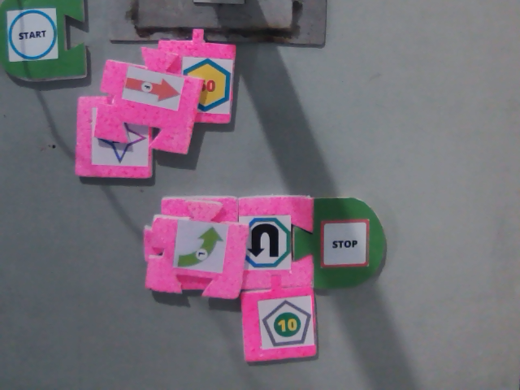

# YOLOBlocks

YOLOBlocks adalah aplikasi Python untuk membaca program dari susunan blok fisik menggunakan webcam. Model YOLOv4 mendeteksi blok, lalu hasilnya diurutkan secara leksikografis untuk diterjemahkan menjadi perintah robot melalui koneksi serial Arduino.

## Contoh susunan blok



Blok `Start` dan `Stop` menandai awal dan akhir program. Blok di antaranya berisi aksi seperti maju, mundur, belok, serta buka/tutup gripper, dengan blok angka sebagai parameter.

## Fitur

- Deteksi blok dengan model YOLOv4 melalui OpenCV DNN.
- Pengurutan berdasarkan pasangan `(baris grid, posisi x)`: baris dibaca dari atas ke bawah, kemudian blok dalam setiap baris dari kiri ke kanan.
- Penggabungan blok aksi dan angka, misalnya `Forward` + `10` menjadi `F10`. Aksi tanpa angka menggunakan nilai `0`.
- Antarmuka Tkinter dengan preview webcam, pilihan kamera, rotasi, flip, dan pembagian grid 1–5 baris.
- Validasi `Start`/`Stop`, penyimpanan hasil ke `output.txt`, dan pengiriman perintah ke robot melalui serial pada 9600 baud (v6/v7).

Contoh hasil perintah:

```text
O0
F10
L60
R90
B50
```

Kode aksi: `F` = maju, `B` = mundur, `L` = kiri, `R` = kanan, `O` = buka, dan `C` = tutup. `Start` dan `Stop` tidak ikut ditulis ke hasil perintah v6/v7.

## Cara menjalankan

Siapkan Python 3 dengan Tkinter, webcam, dan robot/Arduino dengan firmware penerima perintah serial.

1. Instal dependensi:

   ```bash
   python -m pip install opencv-python numpy Pillow pyserial
   ```

2. Pastikan file `.cfg`, `.weights`, dan `obj.names` tersedia di folder proyek. File bobot menggunakan Git LFS; jalankan `git lfs pull` jika bobot belum terunduh.
3. Jalankan dari folder proyek:

   ```bash
   python final-program-v6-new-weights.py
   ```

   Di Windows, bisa juga menggunakan `run-v6.bat`.

4. Pilih webcam dan port COM robot, lalu klik **Cek Koneksi**.
5. Atur rotasi, flip, dan jumlah baris grid agar sesuai dengan susunan blok. Pastikan `Start` terbaca pertama dan `Stop` terakhir, lalu klik **Capture Frame**.

Capture menyimpan gambar ke `Output/Frame.png`. Jika susunan valid, aplikasi menulis perintah ke `output.txt`, mengirimkannya melalui serial, dan menunggu balasan `Semua Perintah Dijalankan` dari Arduino. Firmware Arduino tidak disertakan dalam repositori ini.

## File utama

| File | Keterangan |
| --- | --- |
| `final-program-v4-new-weights.py` | Deteksi dan pengurutan blok tanpa koneksi robot. |
| `final-program-v5-new-weights.py` | Menambahkan penggabungan aksi dan angka serta keluaran perintah. |
| `final-program-v6-new-weights.py` | Menambahkan validasi Start/Stop dan komunikasi serial robot. |
| `final-program-v7-new-weights.py` | Versi dengan tata letak antarmuka yang diperbarui. |
| `custom-yolov4-detector.cfg`, `custom-yolov4-detector_final.weights`, `obj.names` | Konfigurasi, bobot model, dan nama kelas blok. |
| `Demo.mkv` | Video demo proyek. |

Catatan: v7 saat ini memiliki ketidaksesuaian teks status koneksi yang membuat **Capture Frame** tetap ditolak setelah koneksi berhasil. Gunakan v6 untuk alur koneksi dan capture.
